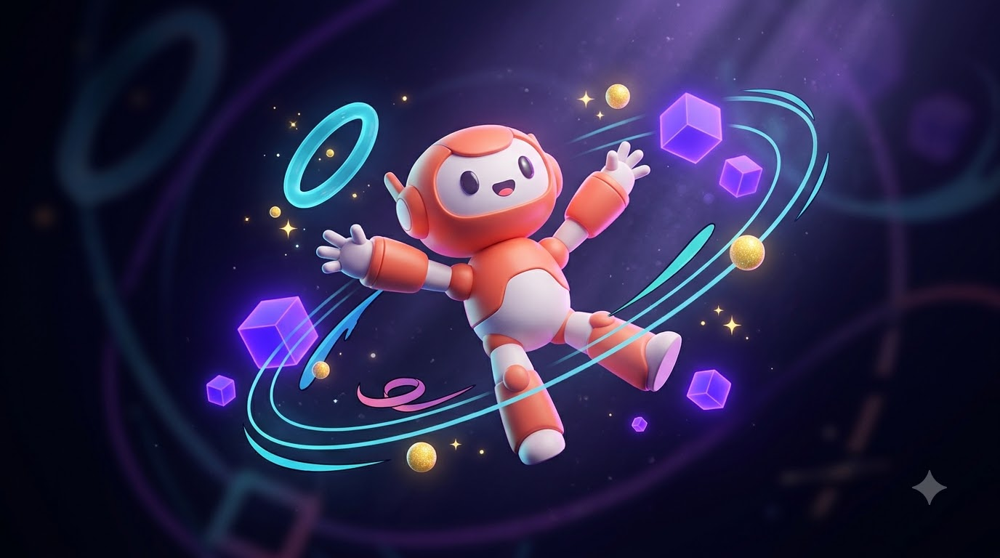

# GOOGLE FLOW IMAGE GENERATION GUIDE — ANIMATION STUDIO

This document provides **complete, copy-ready Google Flow image-generation prompts** for every visual placeholder across the **ANIMATION STUDIO** six-page website (`index.html`, `services.html`, `portfolio.html`, `about.html`, `process.html`, and `contact.html`).

All placeholders on the website are currently rendered using pure CSS3 animated geometric shapes, aspect-ratio containers, and filename badges. Follow this guide to generate high-resolution `.webp` artwork in Google Flow and replace the placeholders when ready.

---

## 1. COMPLETE IMAGE INVENTORY TABLE

| Image # | Exact Filename | Website Page(s) | Section | Aspect Ratio | Recommended Resolution | Orientation |
| :--- | :--- | :--- | :--- | :--- | :--- | :--- |
| **01** | `animation-studio-hero.webp` | `index.html` | Hero Section (`A. Hero Section`) | `16:9` | `1920 × 1080 px` | Landscape |
| **02** | `2d-animation-visual.webp` | `services.html`, `portfolio.html` | Services `#service-2d` & Portfolio Project #7 | `16:9` | `1600 × 900 px` | Landscape |
| **03** | `3d-animation-visual.webp` | `services.html`, `portfolio.html` | Services `#service-3d` & Portfolio Project #8 | `16:9` | `1600 × 900 px` | Landscape |
| **04** | `motion-graphics-visual.webp` | `services.html` | Services `#service-motion` | `16:9` | `1600 × 900 px` | Landscape |
| **05** | `character-animation.webp` | `services.html` | Services `#service-character` | `16:9` | `1600 × 900 px` | Landscape |
| **06** | `explainer-animation.webp` | `index.html`, `services.html`, `portfolio.html` | Featured Project #4, Services `#service-explainer`, Portfolio Project #5 | `16:9` | `1600 × 900 px` | Landscape |
| **07** | `logo-animation.webp` | `services.html`, `portfolio.html` | Services `#service-logo`, Portfolio Project #6 | `16:9` | `1600 × 900 px` | Landscape |
| **08** | `portfolio-2d-animation.webp` | `index.html`, `portfolio.html` | Featured Project #1, Portfolio Project #1 & Modal Preview | `16:9` | `1920 × 1080 px` | Landscape |
| **09** | `portfolio-3d-animation.webp` | `index.html`, `portfolio.html` | Featured Project #2, Portfolio Project #2 | `16:9` | `1920 × 1080 px` | Landscape |
| **10** | `portfolio-motion-graphics.webp` | `index.html`, `portfolio.html` | Featured Project #3, Portfolio Project #3 | `16:9` | `1920 × 1080 px` | Landscape |
| **11** | `portfolio-character-animation.webp` | `portfolio.html` | Portfolio Project #4 | `16:9` | `1920 × 1080 px` | Landscape |
| **12** | `animation-creative-team.webp` | `about.html` | About Hero Section | `4:3` | `1600 × 1200 px` | Landscape |
| **13** | `animation-production-process.webp` | `process.html` | Process Hero Section | `16:9` | `1920 × 1080 px` | Landscape |

---

## 2. PLACEHOLDER SUMMARY & ORIENTATION COUNTS

- **Total Unique Image Filenames / Prompts:** `13`
- **Total HTML Placeholder Instances Across All 6 Pages:** `19` (several core assets are reused across Home Featured Projects, Services, and Portfolio cards for consistency and fast caching)
- **Orientation Breakdown:**
  - **Landscape (`16:9` Widescreen):** `12` unique images
  - **Landscape (`4:3` Editorial):** `1` unique image
  - **Portrait (`9:16`):** `0`
  - **Square (`1:1`):** `0`

---

## 3. EXACT PLACEHOLDER-TO-FILENAME MAPPING

1. **`index.html` (Home Page — 5 Placeholder Instances):**
   - Hero Right Visual Card → `animation-studio-hero.webp`
   - Featured Project Card 1 (2D Animated Brand Story) → `portfolio-2d-animation.webp`
   - Featured Project Card 2 (3D Product Animation) → `portfolio-3d-animation.webp`
   - Featured Project Card 3 (Motion Graphics Commercial) → `portfolio-motion-graphics.webp`
   - Featured Project Card 4 (Animated Explainer Video) → `explainer-animation.webp`

2. **`services.html` (Animation Services Page — 6 Placeholder Instances):**
   - Service 01 (2D Animation) → `2d-animation-visual.webp`
   - Service 02 (3D Animation) → `3d-animation-visual.webp`
   - Service 03 (Motion Graphics) → `motion-graphics-visual.webp`
   - Service 04 (Character Animation) → `character-animation.webp`
   - Service 05 (Explainer Videos) → `explainer-animation.webp`
   - Service 06 (Logo & Brand Animation) → `logo-animation.webp`

3. **`portfolio.html` (Animation Portfolio Page — 8 Placeholder Cards + Interactive Modal):**
   - Project Card 01 (Luminous Horizon — 2D Brand Narrative) → `portfolio-2d-animation.webp`
   - Project Card 02 (ChronoCore — 3D Product & Mechanism Showcase) → `portfolio-3d-animation.webp`
   - Project Card 03 (PulseGrid — Kinetic Typography & Rhythm Reel) → `portfolio-motion-graphics.webp`
   - Project Card 04 (Astro & Pip — Expressive Character Acting Study) → `portfolio-character-animation.webp`
   - Project Card 05 (CloudSync Flow — Isometric Product Explainer) → `explainer-animation.webp`
   - Project Card 06 (PrismWave — Geometric Logo Reveal & Sting) → `logo-animation.webp`
   - Project Card 07 (Botanica — Educational Micro-Documentary) → `2d-animation-visual.webp`
   - Project Card 08 (NeoAtrium — Stylized 3D Environment Sequence) → `3d-animation-visual.webp`

4. **`about.html` (About & Creative Team Page — 1 Main Image Placeholder + 3 CSS Avatar Placeholders):**
   - About Hero Visual → `animation-creative-team.webp`

5. **`process.html` (Animation Production Process Page — 1 Placeholder Instance):**
   - Process Hero Pipeline Illustration → `animation-production-process.webp`

---

## 4. RECOMMENDED IMAGE-GENERATION ORDER

To achieve immediate visual impact across the highest-traffic pages first, generate your images in this priority order:

1. **Priority 1 — Homepage Hero (`animation-studio-hero.webp`)**: Sets the immediate visual tone and colour palette for the entire studio website.
2. **Priority 2 — Core Portfolio Highlights (`portfolio-2d-animation.webp`, `portfolio-3d-animation.webp`, `portfolio-motion-graphics.webp`, `portfolio-character-animation.webp`)**: Populates both the Homepage Featured Work section and the top row of the Portfolio page.
3. **Priority 3 — Shared Service & Portfolio Visuals (`explainer-animation.webp`, `logo-animation.webp`, `2d-animation-visual.webp`, `3d-animation-visual.webp`)**: Completes the remaining Portfolio cards and populates four of the six Services sections.
4. **Priority 4 — Remaining Services Visuals (`motion-graphics-visual.webp`, `character-animation.webp`)**: Completes the Services page.
5. **Priority 5 — About & Process Hero Visuals (`animation-creative-team.webp`, `animation-production-process.webp`)**: Completes the About and Process pages.

---

## 5. DETAILED GOOGLE FLOW PROMPTS (ALL 13 IMAGES)

---

### IMAGE 01: `animation-studio-hero.webp`
- **Image Number:** 01
- **Exact Filename:** `animation-studio-hero.webp`
- **Website Page:** `index.html` (Home)
- **Section:** `A. Hero Section` (Right visual column)
- **Subject Description:** A vibrant, imaginative 3D and 2D hybrid creative composition featuring a friendly stylized floating robot-mascot character surrounded by glowing motion-frame rings, floating geometric spheres, torus shapes, and ribbon trails.
- **Aspect Ratio:** `16:9`
- **Recommended Resolution:** `1920 × 1080 px`
- **Orientation:** Landscape
- **Composition:** Central focal character framed by dynamic diagonal motion trails and orbiting geometric shapes using the golden ratio.
- **Camera Angle:** Slightly low-angle medium shot (`15-degree` upward tilt) for heroic presence and depth.
- **Lighting:** Studio volumetric rim lighting in electric purple and cyan with warm orange key highlights and soft ambient occlusion.
- **Background:** Deep midnight indigo (`#10101A` to `#191927`) smooth studio backdrop with subtle glowing bokeh particles.
- **Visual Style:** Premium international animation studio showcase artwork, tactile 3D clay-and-glass shaders mixed with crisp 2D cel-shaded motion lines.
- **Colour Palette:** Deep midnight (`#10101A`), electric purple (`#8657FF`), bright coral orange (`#FF875C`), luminous cyan (`#40D9E8`), and warm gold (`#FFD166`).
- **Subject Positioning:** Centered main character with orbiting geometric elements extending toward the middle-right; clean breathing room around the outer 15% border.
- **Negative Space for Text Overlays:** Top-left and bottom-right corners kept dark and uncluttered to accommodate floating UI badges.
- **Complete Google Flow Image-Generation Prompt:**
  > `A premium creative animation studio hero illustration in 16:9 widescreen aspect ratio. In the center, a charming stylized 3D animated character with smooth matte coral-orange and white surfaces floats joyfully in mid-air, surrounded by orbiting translucent cyan rings, glowing electric purple geometric cubes, golden spheres, and fluid 2D cel-shaded motion trails. Set against a deep midnight indigo studio background (#10101A and #191927) with volumetric purple and cyan rim lighting, soft depth of field, tactile Pixar-meets-motion-design aesthetic, ultra-clean rendering, vibrant colour harmony (#8657FF, #FF875C, #40D9E8, #FFD166), uncluttered dark corners for UI badges, no text or watermarks.`
- **Negative Prompt:**
  > `text, watermark, company logo, typography, blurry, low resolution, photorealistic human faces, cluttered background, neon eyesore, oversaturated noise, distorted geometry, stock photo look`

---

### IMAGE 02: `2d-animation-visual.webp`
- **Image Number:** 02
- **Exact Filename:** `2d-animation-visual.webp`
- **Website Page:** `services.html` & `portfolio.html`
- **Section:** Services `#service-2d` (2D Animation) & Portfolio Project #7 (Botanica Educational Series)
- **Subject Description:** A richly layered 2D illustrated environment showing stylized botanical flora, glowing bioluminescent leaves, and a curious illustrated explorer character looking through a magnifying glass, rendered with visible multi-plane parallax depth.
- **Aspect Ratio:** `16:9`
- **Recommended Resolution:** `1600 × 900 px`
- **Orientation:** Landscape
- **Composition:** Foreground silhouette leaves framing a mid-ground illustrated character and glowing botanical cross-section, with layered mountains in the background.
- **Camera Angle:** Eye-level widescreen theatrical framing.
- **Lighting:** Warm golden and cyan bioluminescent glow radiating from the center flora against a twilight purple sky.
- **Background:** Layered 2D cut-paper and digital brush twilight forest in deep navy and violet (`#191927`).
- **Visual Style:** High-end 2D editorial vector and painterly illustration with subtle grain texture and expressive line art.
- **Colour Palette:** Twilight navy (`#191927`), electric violet (`#8657FF`), glowing cyan (`#40D9E8`), warm amber (`#FFD166`), and coral (`#FF875C`).
- **Subject Positioning:** Character positioned on the left third looking toward glowing botanical elements on the right third.
- **Negative Space for Text Overlays:** Upper-left sky area kept smooth and dark for badge legibility.
- **Complete Google Flow Image-Generation Prompt:**
  > `A captivating 2D animation styleframe in 16:9 widescreen format. A stylized 2D illustrated explorer character on the left third examines a glowing bioluminescent plant on the right third inside an enchanted twilight garden. Distinct multi-plane parallax layers with dark indigo foreground foliage, painterly brush textures, crisp vector linework, and luminous orbs floating in the air. Colour palette of deep navy (#10101A), electric purple (#8657FF), glowing cyan (#40D9E8), bright orange (#FF875C), and warm yellow (#FFD166). Modern international 2D animation studio aesthetic, clean negative space in the upper corners, no text or watermarks.`
- **Negative Prompt:**
  > `3D photorealism, live action photography, text, subtitles, watermarks, logos, messy sketch lines, washed-out colours, anatomical errors`

---

### IMAGE 03: `3d-animation-visual.webp`
- **Image Number:** 03
- **Exact Filename:** `3d-animation-visual.webp`
- **Website Page:** `services.html` & `portfolio.html`
- **Section:** Services `#service-3d` (3D Animation) & Portfolio Project #8 (NeoAtrium 3D Environment)
- **Subject Description:** A stylized 3D architectural atrium and sculptural floating centerpiece with glass bridges, warm glowing portals, and soft volumetric light beams.
- **Aspect Ratio:** `16:9`
- **Recommended Resolution:** `1600 × 900 px`
- **Orientation:** Landscape
- **Composition:** Symmetrical leading lines drawing the eye toward a floating geometric sculpture in the center of a futuristic creative courtyard.
- **Camera Angle:** Wide-angle cinematic perspective (`24mm` lens feel) with gentle upward tilt.
- **Lighting:** Dramatic volumetric god-rays in cyan and warm orange cutting through a dark purple architectural space.
- **Background:** Stylized 3D minimalist arches and midnight sky gradient (`#10101A`).
- **Visual Style:** High-end 3D architectural and environment visualization with smooth subsurface scattering, frosted glass, and anodized metallic textures.
- **Colour Palette:** Deep obsidian (`#10101A`), slate indigo (`#222238`), electric purple (`#8657FF`), cyan (`#40D9E8`), and sunset orange (`#FF875C`).
- **Subject Positioning:** Central floating geometric sculpture framed by symmetrical 3D walkways on left and right.
- **Negative Space for Text Overlays:** Upper sky and lower floor corners kept clean and dark.
- **Complete Google Flow Image-Generation Prompt:**
  > `A cinematic 3D animation environment styleframe in 16:9 widescreen format. A stylized modern atrium at twilight featuring sleek curved walkways, frosted glass panels, and a levitating kinetic sculpture made of glowing electric purple (#8657FF), cyan (#40D9E8), and warm orange (#FF875C) rings in the center. Dramatic volumetric light beams, soft depth of field, global illumination, rich dark indigo shadows (#10101A and #191927), refined 3D studio render quality, clean negative space along the top and bottom edges, no text or logos.`
- **Negative Prompt:**
  > `text, watermark, people, cars, gritty grunge, low poly jagged edges, overexposed white background, noisy grain`

---

### IMAGE 04: `motion-graphics-visual.webp`
- **Image Number:** 04
- **Exact Filename:** `motion-graphics-visual.webp`
- **Website Page:** `services.html`
- **Section:** Services `#service-motion` (Motion Graphics)
- **Subject Description:** An abstract 2.5D motion graphics composition featuring modular isometric data cards, fluid sound-wave ribbons, geometric progress rings, and kinetic layout frames floating in dark space.
- **Aspect Ratio:** `16:9`
- **Recommended Resolution:** `1600 × 900 px`
- **Orientation:** Landscape
- **Composition:** Isometric diagonal grid flow moving from bottom-left to top-right with layered translucent graphic panels.
- **Camera Angle:** Isometric `30-degree` orthographic camera view.
- **Lighting:** Self-illuminated neon-soft graphic edges with subtle glassmorphism reflections on dark slate cards.
- **Background:** Deep matte navy (`#10101A`) with a faint geometric dot matrix grid.
- **Visual Style:** Contemporary broadcast and digital motion design system, crisp vector geometry with glassmorphic depth.
- **Colour Palette:** Dark navy (`#10101A`), card indigo (`#222238`), cyan (`#40D9E8`), electric purple (`#8657FF`), coral orange (`#FF875C`), and yellow (`#FFD166`).
- **Subject Positioning:** Clustered along the center diagonal with generous dark margin around the perimeter.
- **Negative Space for Text Overlays:** Top-left and bottom-right areas left dark and unobstructed.
- **Complete Google Flow Image-Generation Prompt:**
  > `A sleek motion graphics design composition in 16:9 widescreen aspect ratio. Floating isometric glassmorphic interface cards, abstract equalizer wave bars, circular radial charts, and smooth geometric ribbon transitions arranged in a dynamic diagonal flow. Set against a deep dark navy background (#10101A) with subtle grid points. Vibrant accent colours in electric purple (#8657FF), cyan (#40D9E8), bright orange (#FF875C), and yellow (#FFD166). Crisp vector edges, subtle depth-of-field blur on background elements, no readable words or numbers, no watermarks.`
- **Negative Prompt:**
  > `readable text, gibberish letters, numbers, watermarks, human faces, messy wires, realistic photographs, bright white background`

---

### IMAGE 05: `character-animation.webp`
- **Image Number:** 05
- **Exact Filename:** `character-animation.webp`
- **Website Page:** `services.html`
- **Section:** Services `#service-character` (Character Animation)
- **Subject Description:** A character design and animation turnaround showcase featuring an expressive stylized mascot character in three dynamic poses (joyful leap, curious wave, and thoughtful stance) with subtle motion arc guides.
- **Aspect Ratio:** `16:9`
- **Recommended Resolution:** `1600 × 900 px`
- **Orientation:** Landscape
- **Composition:** Triptych horizontal arrangement showing three expressive poses of the same original character across a studio stage.
- **Camera Angle:** Eye-level full-body character framing.
- **Lighting:** Soft three-point animation studio lighting with purple and cyan rim lights and soft floor contact shadows.
- **Background:** Dark indigo stage (`#191927`) with subtle glowing motion arc lines connecting the poses.
- **Visual Style:** Stylized 2D/3D hybrid character design sheet with appealing rounded proportions and expressive eyes.
- **Colour Palette:** Dark stage (`#191927`), bright orange (`#FF875C`), warm yellow (`#FFD166`), cyan (`#40D9E8`), and electric purple (`#8657FF`).
- **Subject Positioning:** Three evenly spaced character poses across the center horizontal axis.
- **Negative Space for Text Overlays:** Top and bottom 18% margins kept clean and dark.
- **Complete Google Flow Image-Generation Prompt:**
  > `A character animation showcase illustration in 16:9 widescreen format. An original, friendly stylized animated character with a rounded helmet-like head, expressive eyes, and a vibrant orange (#FF875C) and cyan (#40D9E8) outfit shown in three sequential action poses across the frame—standing curiously, leaping with joy, and waving warmly. Subtle glowing yellow (#FFD166) and electric purple (#8657FF) motion arc trails connect the poses against a dark studio background (#191927). Appeal-focused character design, clean studio lighting, no text or labels.`
- **Negative Prompt:**
  > `copyrighted characters, Disney, Pixar, Nintendo, Marvel, text labels, watermarks, uncanny valley human skin, extra limbs, distorted hands`

---

### IMAGE 06: `explainer-animation.webp`
- **Image Number:** 06
- **Exact Filename:** `explainer-animation.webp`
- **Website Page:** `index.html`, `services.html`, & `portfolio.html`
- **Section:** Home Featured Project #4, Services `#service-explainer`, Portfolio Project #5
- **Subject Description:** A clean, imaginative animated explainer concept illustration showing a glowing lightbulb idea transforming along a conveyor of floating geometric nodes into a polished digital screen and Rocket icon.
- **Aspect Ratio:** `16:9`
- **Recommended Resolution:** `1600 × 900 px`
- **Orientation:** Landscape
- **Composition:** Left-to-right visual storytelling flow (Problem/Idea → Process Nodes → Solution Reveal).
- **Camera Angle:** Slight isometric overview (`25-degree` angle).
- **Lighting:** Soft studio glow radiating from the lightbulb and connected pathway nodes.
- **Background:** Deep slate navy (`#10101A` and `#222238`) with clean vector path lines.
- **Visual Style:** Premium modern explainer video art direction—clean 3D-shaded vector icons and smooth gradients.
- **Colour Palette:** Midnight (`#10101A`), warm yellow (`#FFD166`), cyan (`#40D9E8`), electric purple (`#8657FF`), and coral orange (`#FF875C`).
- **Subject Positioning:** Visual metaphor flowing horizontally across the middle band of the frame.
- **Negative Space for Text Overlays:** Top and bottom margins left dark for UI badges.
- **Complete Google Flow Image-Generation Prompt:**
  > `A modern animated explainer video styleframe in 16:9 widescreen aspect ratio. A visual storytelling flow from left to right: a glowing golden lightbulb (#FFD166) on the left connects via luminous cyan (#40D9E8) and electric purple (#8657FF) pathway tubes to floating modular puzzle cubes in the center, culminating in a sleek stylized launch module in bright coral orange (#FF875C) on the right. Set against a clean dark navy background (#10101A). Smooth 2.5D vector-meets-3D shading, clear visual metaphor, uncluttered margins, no text or numbers.`
- **Negative Prompt:**
  > `text, words, charts with numbers, cluttered mess, photorealistic office people, stock photo, watermark`

---

### IMAGE 07: `logo-animation.webp`
- **Image Number:** 07
- **Exact Filename:** `logo-animation.webp`
- **Website Page:** `services.html` & `portfolio.html`
- **Section:** Services `#service-logo` & Portfolio Project #6 (PrismWave Logo Reveal)
- **Subject Description:** An abstract geometric play-triangle and prism emblem forming in mid-air from swirling ribbons of light, glass shards, and glowing particle trails (strictly no letters or company names).
- **Aspect Ratio:** `16:9`
- **Recommended Resolution:** `1600 × 900 px`
- **Orientation:** Landscape
- **Composition:** Bullseye central composition with swirling radial energy converging into a crisp geometric play-prism mark.
- **Camera Angle:** Straight-on centered studio view with shallow depth of field.
- **Lighting:** Luminous internal glow from the prism casting purple, cyan, and orange reflections onto surrounding ribbons.
- **Background:** Rich dark obsidian (`#10101A`).
- **Visual Style:** High-end broadcast logo sting and motion identity artwork.
- **Colour Palette:** Obsidian (`#10101A`), electric purple (`#8657FF`), cyan (`#40D9E8`), bright orange (`#FF875C`), and gold (`#FFD166`).
- **Subject Positioning:** Dead-center geometric mark occupying 50% of the frame height, surrounded by sweeping motion trails.
- **Negative Space for Text Overlays:** Outer 20% perimeter kept dark and clean.
- **Complete Google Flow Image-Generation Prompt:**
  > `A high-end abstract logo animation reveal frame in 16:9 widescreen format. At the center, a sleek geometric prism and play-button emblem (pure geometric shapes only, no letters or words) assembles from dynamic swirling ribbons of electric purple (#8657FF), luminous cyan (#40D9E8), bright orange (#FF875C), and golden light (#FFD166). Set against a deep dark background (#10101A) with subtle refractive glass highlights and fine glowing particles. Premium motion identity design, crisp edges, zero typography or text.`
- **Negative Prompt:**
  > `letters, alphabet, company name, typography, watermark, blurry edges, cluttered background, white background`

---

### IMAGE 08: `portfolio-2d-animation.webp`
- **Image Number:** 08
- **Exact Filename:** `portfolio-2d-animation.webp`
- **Website Page:** `index.html` & `portfolio.html`
- **Section:** Home Featured Project #1 & Portfolio Project #1 (Luminous Horizon — 2D Brand Narrative)
- **Subject Description:** A breathtaking 2D animated nocturnal cityscape where a warm glowing paper lantern drifts above stylized rooftops, bridges, and reflective canals under a starry indigo sky.
- **Aspect Ratio:** `16:9`
- **Recommended Resolution:** `1920 × 1080 px`
- **Orientation:** Landscape
- **Composition:** Rule-of-thirds placement with the glowing lantern in the upper-right third casting warm reflections across diagonal canal waterways below.
- **Camera Angle:** Cinematic sweeping crane view looking across the rooftops.
- **Lighting:** Contrast between the warm orange/yellow lantern glow and the cool purple/cyan moonlight on the city rooftops.
- **Background:** Deep indigo night sky (`#10101A`) with stylized clouds and distant city silhouettes.
- **Visual Style:** Feature-quality 2D animated film background art with rich painterly textures and atmospheric glow.
- **Colour Palette:** Night indigo (`#10101A`), violet rooftops (`#222238`, `#8657FF`), cyan water reflections (`#40D9E8`), and warm lantern orange/gold (`#FF875C`, `#FFD166`).
- **Subject Positioning:** Glowing lantern in upper-right focal point; sweeping bridge and water leading from bottom-left.
- **Negative Space for Text Overlays:** Upper-left sky and lower-right water kept smooth for UI overlays and play button visibility.
- **Complete Google Flow Image-Generation Prompt:**
  > `A feature-quality 2D animation keyframe in 16:9 widescreen aspect ratio titled Luminous Horizon. A warm glowing coral-orange and golden paper lantern (#FF875C, #FFD166) floats gracefully above a stylized 2D illustrated nocturnal city with layered violet rooftops (#222238, #8657FF) and a tranquil canal reflecting cyan moonlight (#40D9E8). Multi-plane parallax depth, expressive hand-painted brush textures, atmospheric glow, deep midnight sky (#10101A), no text or watermarks.`
- **Negative Prompt:**
  > `photorealistic photo, 3D CAD wireframe, text, subtitles, watermark, daytime bright sun, cluttered signs`

---

### IMAGE 09: `portfolio-3d-animation.webp`
- **Image Number:** 09
- **Exact Filename:** `portfolio-3d-animation.webp`
- **Website Page:** `index.html` & `portfolio.html`
- **Section:** Home Featured Project #2 & Portfolio Project #2 (ChronoCore — 3D Product & Mechanism Showcase)
- **Subject Description:** A precision 3D exploded-view animation frame of a futuristic spherical audio-core device, showing floating anodized rings, glowing cyan acoustic lenses, and brushed metallic internal gears in mid-assembly.
- **Aspect Ratio:** `16:9`
- **Recommended Resolution:** `1920 × 1080 px`
- **Orientation:** Landscape
- **Composition:** Dynamic diagonal exploded-view axis from bottom-left to top-right with crisp alignment trails.
- **Camera Angle:** Macro three-quarter studio product camera angle with shallow depth of field.
- **Lighting:** High-contrast studio rim lighting in electric purple and cyan with warm orange internal core glow.
- **Background:** Seamless dark studio cyclorama (`#10101A` to `#191927`).
- **Visual Style:** Cinema-grade 3D product visualization and hardware reveal animation.
- **Colour Palette:** Matte obsidian (`#10101A`), brushed titanium (`#B8B8C9`), electric purple (`#8657FF`), cyan (`#40D9E8`), and orange core (`#FF875C`).
- **Subject Positioning:** Centered along a 30-degree diagonal axis with components suspended in zero gravity.
- **Negative Space for Text Overlays:** Top-left and bottom-right corners kept dark and clean.
- **Complete Google Flow Image-Generation Prompt:**
  > `A high-end 3D product animation keyframe in 16:9 widescreen format. An exploded-view assembly of a futuristic spherical sound core suspended in mid-air: matte dark titanium shells, glowing cyan (#40D9E8) acoustic rings, electric purple (#8657FF) glass lenses, and a warm orange (#FF875C) central energy core aligned along a diagonal axis. Studio rim lighting, realistic brushed metal and frosted glass shaders, shallow depth of field, seamless dark background (#10101A), no brand names or text.`
- **Negative Prompt:**
  > `brand logos, Apple, Sony, text, serial numbers, watermark, messy cables, bright white background, low resolution`

---

### IMAGE 10: `portfolio-motion-graphics.webp`
- **Image Number:** 10
- **Exact Filename:** `portfolio-motion-graphics.webp`
- **Website Page:** `index.html` & `portfolio.html`
- **Section:** Home Featured Project #3 & Portfolio Project #3 (PulseGrid — Kinetic Typography & Rhythm Reel)
- **Subject Description:** A high-energy abstract motion graphics frame featuring rhythmic soundwave bars, interlocking geometric chevrons, concentric pulse circles, and dynamic split-screen colour blocks.
- **Aspect Ratio:** `16:9`
- **Recommended Resolution:** `1920 × 1080 px`
- **Orientation:** Landscape
- **Composition:** Bold Swiss-grid inspired geometric division with central rhythmic wave focal point.
- **Camera Angle:** Flat 2D/2.5D graphic camera view with layered drop shadows.
- **Lighting:** Flat graphic illumination with glowing neon accents and crisp vector shadows.
- **Background:** Deep dark indigo (`#10101A`) divided by sharp geometric grid lines (`#222238`).
- **Visual Style:** Festival-grade motion design showreel frame, vibrant vector geometry and kinetic rhythm.
- **Colour Palette:** Deep indigo (`#10101A`), electric purple (`#8657FF`), bright orange (`#FF875C`), cyan (`#40D9E8`), and yellow (`#FFD166`).
- **Subject Positioning:** Balanced across a modular 3x3 graphic grid with a central circular wave burst.
- **Negative Space for Text Overlays:** Outer frame borders kept clean for card badges.
- **Complete Google Flow Image-Generation Prompt:**
  > `A vibrant motion graphics commercial styleframe in 16:9 widescreen aspect ratio. A bold modular geometric grid composition featuring dynamic audio equalizer waves in the center, interlocking triangles, concentric rings, and fluid diagonal motion streaks. Coloured in electric purple (#8657FF), bright coral orange (#FF875C), cyan (#40D9E8), and warm yellow (#FFD166) against a dark midnight background (#10101A and #222238). Crisp vector precision, subtle 2.5D depth shadows, energetic rhythm, no words or text.`
- **Negative Prompt:**
  > `readable words, letters, numbers, watermarks, photorealistic textures, muddy colours, blurry motion`

---

### IMAGE 11: `portfolio-character-animation.webp`
- **Image Number:** 11
- **Exact Filename:** `portfolio-character-animation.webp`
- **Website Page:** `portfolio.html`
- **Section:** Portfolio Project #4 (Astro & Pip — Expressive Character Acting Study)
- **Subject Description:** A charming duo of original stylized animated characters—a rounded explorer character in a purple-and-white suit and a tiny hovering glowing cyan companion orb—sharing a surprised, joyful reaction in a stylized cosmic observatory.
- **Aspect Ratio:** `16:9`
- **Recommended Resolution:** `1920 × 1080 px`
- **Orientation:** Landscape
- **Composition:** Two-shot medium close-up with the main character on the left third and the glowing companion hovering on the right third.
- **Camera Angle:** Eye-level intimate storytelling angle.
- **Lighting:** Warm cyan and golden glow from the hovering companion illuminating the main character's expressive face against a dark violet observatory backdrop.
- **Background:** Stylized dark observatory interior (`#191927`) with soft bokeh starlight.
- **Visual Style:** Feature animation character acting study with appealing silhouettes and expressive eyes.
- **Colour Palette:** Deep violet (`#191927`), electric purple (`#8657FF`), cyan (`#40D9E8`), coral orange (`#FF875C`), and warm yellow (`#FFD166`).
- **Subject Positioning:** Balanced left-and-right character interaction across the center horizontal line.
- **Negative Space for Text Overlays:** Upper corners and bottom edge kept dark and simple.
- **Complete Google Flow Image-Generation Prompt:**
  > `An expressive character animation keyframe in 16:9 widescreen format titled Astro and Pip. On the left, an original stylized animated character wearing a sleek purple (#8657FF) and coral-orange (#FF875C) explorer suit smiles with wide expressive eyes while looking at a tiny, cute hovering cyan (#40D9E8) and golden (#FFD166) companion orb on the right. Soft rim lighting, warm facial illumination, stylized dark indigo observatory background (#10101A) with soft bokeh lights, appealing proportions, no text or watermarks.`
- **Negative Prompt:**
  > `existing copyrighted characters, Wall-E, Eve, Astro Bot, text, watermark, realistic human pores, creepy expressions, extra fingers`

---

### IMAGE 12: `animation-creative-team.webp`
- **Image Number:** 12
- **Exact Filename:** `animation-creative-team.webp`
- **Website Page:** `about.html`
- **Section:** About Hero Section (Right visual column)
- **Subject Description:** An artistic stylized illustration of a creative animation studio desk and storyboard wall—featuring glowing drawing tablets, floating storyboard cards, colour palette swatches, 3D geometric maquettes, and motion curves (no real human photographs).
- **Aspect Ratio:** `4:3`
- **Recommended Resolution:** `1600 × 1200 px`
- **Orientation:** Landscape (`4:3` Editorial)
- **Composition:** Elevated three-quarter view of an imaginative creative workstation with floating storyboard panels rising upward.
- **Camera Angle:** `30-degree` elevated studio perspective.
- **Lighting:** Warm desk lamp glow combined with cyan and electric purple screen illumination.
- **Background:** Dark creative studio wall (`#191927`) pinned with glowing concept art frames.
- **Visual Style:** Stylized 3D/2D editorial illustration celebrating animation craft and design tools.
- **Colour Palette:** Studio dark (`#10101A`, `#191927`), electric purple (`#8657FF`), cyan (`#40D9E8`), bright orange (`#FF875C`), and yellow (`#FFD166`).
- **Subject Positioning:** Centered workstation and floating storyboard frames filling the middle 75% of the `4:3` canvas.
- **Negative Space for Text Overlays:** Top and bottom 12% margins kept dark for placeholder badges.
- **Complete Google Flow Image-Generation Prompt:**
  > `A stylized 3D and 2D illustration of an imaginative animation studio creative workspace in 4:3 aspect ratio. A sleek dark desk featuring a glowing digital pen display, physical character maquette sculptures, colour swatch cards, and floating holographic storyboard panels and motion bezier curves rising into the air. Illuminated by warm coral-orange (#FF875C), electric purple (#8657FF), cyan (#40D9E8), and yellow (#FFD166) studio lights against a dark indigo background (#10101A). No real people or photographs, no brand logos or text.`
- **Negative Prompt:**
  > `photorealistic office workers, real human faces, Apple logo, Wacom logo, readable text, cluttered cables, daytime stock photo`

---

### IMAGE 13: `animation-production-process.webp`
- **Image Number:** 13
- **Exact Filename:** `animation-production-process.webp`
- **Website Page:** `process.html`
- **Section:** Process Hero Section (Right visual column)
- **Subject Description:** A visual transformation pipeline illustration showing a single geometric character evolving across five connected floating stages from left to right: (1) wireframe sketch, (2) storyboard panel, (3) flat colour design, (4) rigged 3D/2D pose, and (5) fully lit final rendered frame.
- **Aspect Ratio:** `16:9`
- **Recommended Resolution:** `1920 × 1080 px`
- **Orientation:** Landscape
- **Composition:** Five sequential floating glass frames arranged in a smooth S-curve or diagonal progression from left to right.
- **Camera Angle:** Isometric widescreen overview.
- **Lighting:** Progressive lighting that starts as clean cyan sketch lines on the left and builds into full vibrant volumetric purple, orange, and gold lighting on the right.
- **Background:** Deep midnight indigo (`#10101A`) with glowing timeline connector lines.
- **Visual Style:** Educational and artistic animation pipeline visualization.
- **Colour Palette:** Midnight (`#10101A`), cyan (`#40D9E8`), electric purple (`#8657FF`), bright orange (`#FF875C`), and yellow (`#FFD166`).
- **Subject Positioning:** Five sequential frames evenly distributed across the horizontal axis.
- **Negative Space for Text Overlays:** Top and bottom 15% areas kept dark and unobstructed.
- **Complete Google Flow Image-Generation Prompt:**
  > `An artistic 16:9 widescreen illustration of the 5-stage animation production process. Five floating translucent frames arranged from left to right connected by a glowing light trail: Frame 1 shows a glowing cyan (#40D9E8) concept sketch, Frame 2 shows a sequential storyboard grid, Frame 3 shows vibrant colour palette development (#FFD166, #FF875C), Frame 4 shows motion keyframes and rigging arcs (#8657FF), and Frame 5 reveals a fully lit, polished 3D/2D animated character scene. Deep dark background (#10101A), cohesive studio aesthetic, no text or numbers.`
- **Negative Prompt:**
  > `readable text, numbers, stage labels, watermarks, real photographs, messy diagram, white background`

---

## 6. INSTRUCTIONS FOR REPLACING PLACEHOLDERS WITH GENERATED IMAGES

Once you have generated your `.webp` images using the prompts above, follow these steps to replace the CSS placeholders:

1. **Create an `images/` folder** in the root directory of the project:
   ```text
   Animation Studio/
   ├── index.html
   ├── services.html
   ├── portfolio.html
   ├── about.html
   ├── process.html
   ├── contact.html
   ├── css/
   │   └── styles.css
   ├── js/
   │   └── main.js
   └── images/
       ├── animation-studio-hero.webp
       ├── 2d-animation-visual.webp
       ├── 3d-animation-visual.webp
       ├── motion-graphics-visual.webp
       ├── character-animation.webp
       ├── explainer-animation.webp
       ├── logo-animation.webp
       ├── portfolio-2d-animation.webp
       ├── portfolio-3d-animation.webp
       ├── portfolio-motion-graphics.webp
       ├── portfolio-character-animation.webp
       ├── animation-creative-team.webp
       └── animation-production-process.webp
   ```

2. **Locate the `.img-placeholder` containers in the HTML files:**
   Every placeholder in the HTML displays its exact target filename inside `<span class="placeholder-filename">filename.webp</span>`.

3. **Replace or overlay the placeholder with a semantic `` tag:**
   Replace the `<div class="img-placeholder ...">...</div>` block with a standard responsive `` element while preserving the aspect ratio class:
   ```html
   
   ```
   *(Tip: Keep `loading="eager"` on `animation-studio-hero.webp` on `index.html` for optimal Largest Contentful Paint, and use `loading="lazy"` on all below-the-fold images.)*
